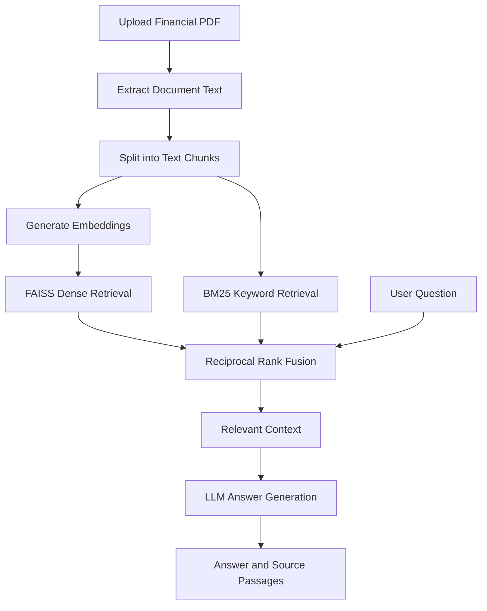

# 📊 FinSight — Financial Report Analyzer

<p align="center">
  
  
  
  
</p>

<p align="center">
  <b>Turn lengthy financial reports into answers you can understand.</b>
  <br />
  An AI-powered application for querying, analyzing, and comparing financial annual reports using natural language.
</p>

<p align="center">
  🚀 <a href="https://finsightai-jlgedznpkq8qgngawnapsj.streamlit.app/"><b>Launch FinSight</b></a>
  &nbsp; • &nbsp;
  💻 <a href="https://github.com/sunidhi76/FinSightAI">GitHub Repository</a>
</p>

---

## 🌟 About the Project

**FinSight** is a Retrieval-Augmented Generation (RAG) application designed to simplify the analysis of lengthy financial annual reports. Users can upload PDF documents, ask questions in plain English, retrieve relevant passages, and explore financial information without manually searching hundreds of pages.

The application combines semantic search, keyword retrieval, and large language models to provide context-grounded responses with supporting document references.

## ✨ Key Features

| Feature | Description |
|---|---|
| 📄 PDF Analysis | Upload and process financial annual reports. |
| 💬 Natural Language Q&A | Ask questions about revenue, risks, margins, and company disclosures. |
| 🔎 Hybrid Retrieval | Combines FAISS dense search and BM25 keyword search using Reciprocal Rank Fusion. |
| 📚 Source References | View retrieved report passages to help verify answers. |
| 🏢 Company Comparison | Explore and compare information from multiple reports. |
| 📈 Key Metrics | Extract and review selected financial metrics. |
| 🤖 LLM Integration | Supports Google Gemini and a configurable Ollama fallback. |
| ☁️ Cloud Deployment | Access the application through Streamlit Community Cloud. |

## 🛠️ Tech Stack

<p>
  
  
  
  
  
  
</p>

- **Language:** Python
- **Frontend:** Streamlit
- **Vector Search:** FAISS
- **Keyword Search:** BM25
- **Embeddings:** Sentence Transformers (`all-MiniLM-L6-v2`)
- **Retrieval Strategy:** Hybrid retrieval with Reciprocal Rank Fusion (RRF)
- **Language Models:** Google Gemini and Ollama
- **Document Input:** PDF annual reports
- **Deployment:** Streamlit Community Cloud

## ⚙️ How It Works



1. **Document ingestion:** Extract text from uploaded PDF reports.
2. **Chunking:** Divide the text into manageable, overlapping sections.
3. **Embedding:** Represent document chunks as numerical vectors.
4. **Retrieval:** Search using dense embeddings and keyword matching.
5. **Fusion:** Combine retrieval rankings using RRF.
6. **Generation:** Provide the retrieved context to the configured language model.
7. **Verification:** Display relevant source passages alongside the generated response.

## 🚀 Getting Started

### Prerequisites

- Python installed on your system
- Git
- A Google Gemini API key, if using Gemini
- Ollama installed and running, if using the local Ollama provider

### 1. Clone the repository

```bash
git clone https://github.com/sunidhi76/FinSightAI.git
cd FinSightAI/finsight/finsight
```

### 2. Create a virtual environment

```bash
python -m venv venv
```

Activate it on Windows:

```bash
venv\Scripts\activate
```

### 3. Install dependencies

```bash
pip install -r requirements.txt
```

### 4. Configure environment variables

Create a `.env` file in the application directory:

```env
LLM_PROVIDER=gemini
GEMINI_API_KEY=your_gemini_api_key
GEMINI_MODEL=your_supported_gemini_model
FALLBACK_PROVIDER=ollama
OLLAMA_MODEL=llama3.2:3b
```

Replace the example values with your actual configuration. Never upload your `.env` file or expose API credentials publicly.

### 5. Run FinSight

```bash
streamlit run app.py
```

Open the local URL provided in your terminal.

## 🖥️ Live Demo

<p align="center">
  <a href="https://finsightai-jlgedznpkq8qgngawnapsj.streamlit.app/">
    
  </a>
</p>

🔗 **Application URL:** https://finsightai-jlgedznpkq8qgngawnapsj.streamlit.app/

## 🔮 Future Enhancements

- 🎯 Improve retrieval accuracy for numerical and comparative questions.
- 📌 Strengthen citation validation and answer grounding.
- 📊 Expand year-over-year financial analysis.
- 🧪 Add automated evaluation and regression tests.
- 📑 Improve extraction of tables and financial statements from PDFs.

## ⚠️ Limitations

- Response accuracy depends on document quality and retrieval relevance.
- Generated answers and financial figures should be verified against the original report.
- LLM availability depends on provider configuration and credentials.
- A local Ollama installation is not automatically available to the cloud deployment.

## ⚖️ Disclaimer

FinSight is an educational project for financial document exploration. It does not provide financial, investment, or legal advice. Always consult the original reports before relying on extracted figures or conclusions.

## 👩‍💻 Author

**Sunidhi**

🐙 GitHub: [@sunidhi76](https://github.com/sunidhi76)

---

<p align="center">
  <b>Built with Python, RAG, and a little curiosity. 💜</b>
  <br />
  ⭐ If you find this project interesting, consider giving the repository a star!
</p>
