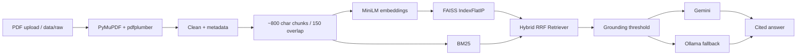

# FinSight — Financial Report Analyser (RAG)

FinSight is a hackathon-ready Retrieval-Augmented Generation application for an equity research analyst or retail investor who needs answers across 3–5 long annual reports without manually searching 100+ page PDFs.

## Why annual reports?
Annual reports are public, dense, numeric, and long. They contain revenue, margins, risks, guidance, accounting explanations and other information that is hard to compare with Ctrl+F alone. FinSight performs query-time retrieval; **there is no model training or fine-tuning**.

## Architecture



## Chunking rationale
Chunks are approximately 800 characters with 150 characters of overlap. The splitter prefers paragraph, line, sentence and clause boundaries, which preserves enough local context for financial statements while avoiding unnecessarily large prompts. Page, company, fiscal year and section metadata stay attached to every chunk. Tables are kept as extracted text as far as the PDF parser permits; table-heavy reports can still require manual review because PDF table extraction is inherently imperfect.

## Features
- FAISS dense retrieval + BM25 keyword retrieval + Reciprocal Rank Fusion.
- Dense-only, BM25-only and Hybrid modes.
- Optional company/year filters.
- Gemini via official `google-genai`, with automatic Ollama fallback.
- Ollama uses `/api/chat`, `num_ctx=8192`, temperature 0 and JSON mode when required.
- Disk cache to avoid repeated paid/free-tier LLM calls.
- Follow-up query rewriting and last-four-turn conversation memory.
- Grounded/not-found badge, confidence meter and source cards.
- Compare mode for two companies.
- Key-metric extraction with Plotly.
- Multi-PDF upload mode; uploads remain session-only.
- Evaluation harness and setup checker.

## Setup

### Windows PowerShell / VS Code
```powershell
python -m venv .venv
.\.venv\Scripts\Activate.ps1
python -m pip install --upgrade pip
pip install -r requirements.txt
copy .env.example .env
# Edit .env and set GEMINI_API_KEY and GEMINI_MODEL
python check_setup.py
streamlit run app.py
```

If PowerShell blocks activation:
```powershell
Set-ExecutionPolicy -Scope Process -ExecutionPolicy Bypass
.\.venv\Scripts\Activate.ps1
```

### macOS / Linux
```bash
python3 -m venv .venv
source .venv/bin/activate
python -m pip install --upgrade pip
pip install -r requirements.txt
cp .env.example .env
# Edit .env and set GEMINI_API_KEY and GEMINI_MODEL
python check_setup.py
streamlit run app.py
```

**Exact run order:** `python check_setup.py` → `streamlit run app.py`.

## Usage
1. Add 1–5 public annual-report PDFs from the sidebar, or place them in `data/raw/` and click **Load sample reports**.
2. Filenames such as `Infosys_FY2026.pdf` automatically infer company and fiscal year.
3. Ask direct fact questions, rephrased questions, risk/guidance questions, or compare two companies.
4. Open **How I searched** to see original/re-written query, retrieval mode and chunks.
5. Inspect source cards for company, fiscal year, page, section, passage and relevance.
6. Use **Key metrics** for revenue, net profit, EPS and YoY growth.

### Fast demo ingestion
For 300+ page reports, use selected page ranges/sections in the ingestion functions when embedding the project into a custom workflow. The UI shows ingestion progress and chunk counts. The core session upload path is intentionally non-persistent.

## LLM configuration
`.env.example` contains the requested six settings. Gemini is the primary provider. `GEMINI_MODEL` is never hardcoded; it must be a currently available model ID. If Gemini returns quota/rate-limit/network/timeout errors, FinSight retries with exponential backoff and falls back to Ollama. Ollama is local-only and is checked gracefully at startup.

## Evaluation
Run:
```bash
python eval.py --provider gemini
python eval.py --provider ollama
```
`test_questions.json` contains six benchmark questions. `eval.py` records retrieval hit@5, keyword correctness, citation presence, refusal correctness, latency and provider. It uses the disk cache and a delay between calls.

## Limitations
- Scanned PDFs with no text layer require OCR; this project warns instead of silently producing bad chunks.
- PDF table extraction can fragment complex tables.
- Numeric units can differ between companies, so answers should preserve units and fiscal year.
- Ollama fallback only works locally; Streamlit Community Cloud cannot reach your local Ollama.
- The supplied evaluation question pages/gold answers are intentionally empty until real sample reports are supplied; populate them for meaningful benchmark scores.

## Streamlit Community Cloud
1. Push the source code, **not PDFs or `.env`**, to GitHub.
2. Create a Streamlit Community Cloud app pointing to `app.py`.
3. In app settings, add secrets:
```toml
GEMINI_API_KEY = "your-key"
GEMINI_MODEL = "your-current-model"
LLM_PROVIDER = "gemini"
FALLBACK_PROVIDER = "ollama"
OLLAMA_MODEL = "llama3.2:3b"
OLLAMA_HOST = "http://localhost:11434"
```
4. Build the index on first run by uploading reports, or include only legally redistributable sample files in `data/raw/`.
5. Ollama fallback is local-only on this deployment and must degrade gracefully.

## 3-minute judge demo
**0:00–0:35 — easy fact:** Load two reports and ask “What was the latest-year revenue?” Open a source card and point to the page and fiscal year.

**0:35–1:10 — rephrased question:** Ask “How much did the company earn in sales during the year?” Switch between Dense only and Hybrid. Explain that BM25 preserves exact financial terminology while dense retrieval handles semantic wording; RRF merges both.

**1:10–1:35 — refusal:** Ask “What is the CEO's favourite food?” Show the red **Not in documents** badge and exact refusal.

**1:35–2:15 — compare:** Enable Compare mode and ask “Compare latest-year revenue.” Show the side-by-side company view.

**2:15–3:00 — upload live:** Upload a new PDF, enter its company/year if needed, build the session index, and ask a question. Emphasize that uploaded PDFs are not written to the repository.

## 10-line troubleshooting
1. Gemini 429 → wait for quota reset; repeated questions use the disk cache.
2. Wrong model name → run `python check_setup.py` and choose a currently listed model.
3. Missing Gemini key → set `GEMINI_API_KEY` in `.env` or Streamlit secrets.
4. Ollama not running → start Ollama; FinSight keeps working with Gemini.
5. Ollama model missing → `ollama pull llama3.2:3b` or change `OLLAMA_MODEL`.
6. Ollama context truncation → FinSight sets `num_ctx=8192` and sends only the top 3–4 chunks to local models.
7. Scanned PDF → use a text-based PDF or OCR it before ingestion.
8. Empty index → add PDFs and rebuild the session index.
9. Weak retrieval → try Hybrid, raise/lower k, and check company/year filters.
10. Unit mismatch → inspect the cited source page and ask explicitly for the unit/fiscal year.

## Safety / privacy
API keys are never logged or displayed in full. `.gitignore` excludes `.env`, local PDFs, indexes and Streamlit secrets.
